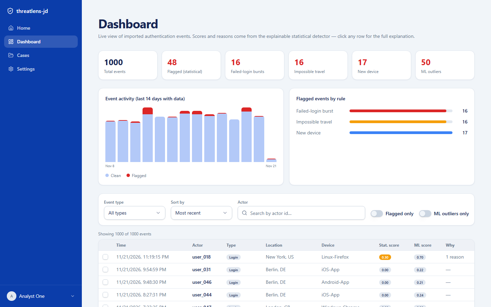
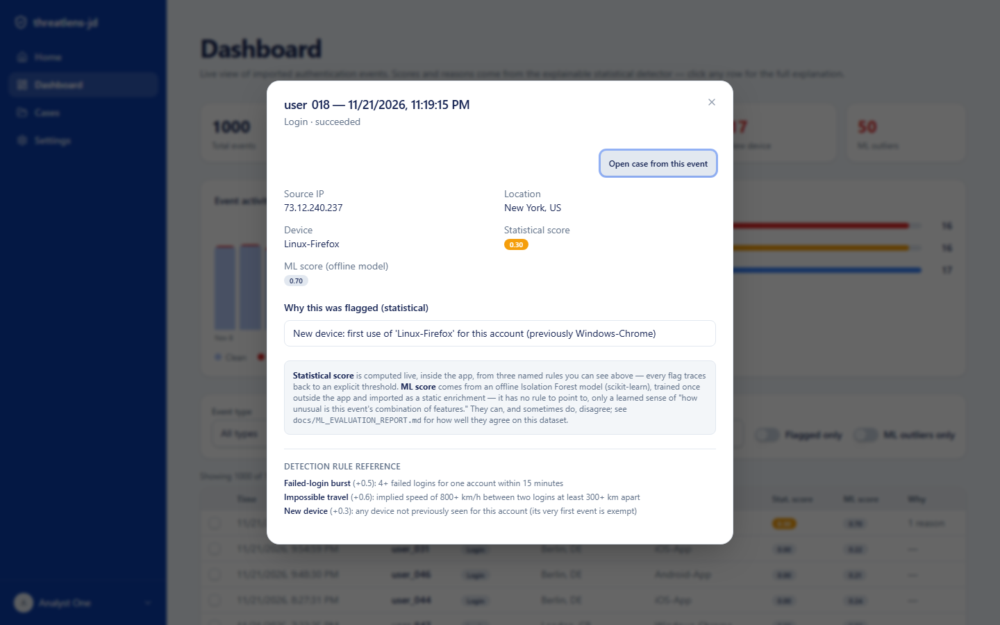
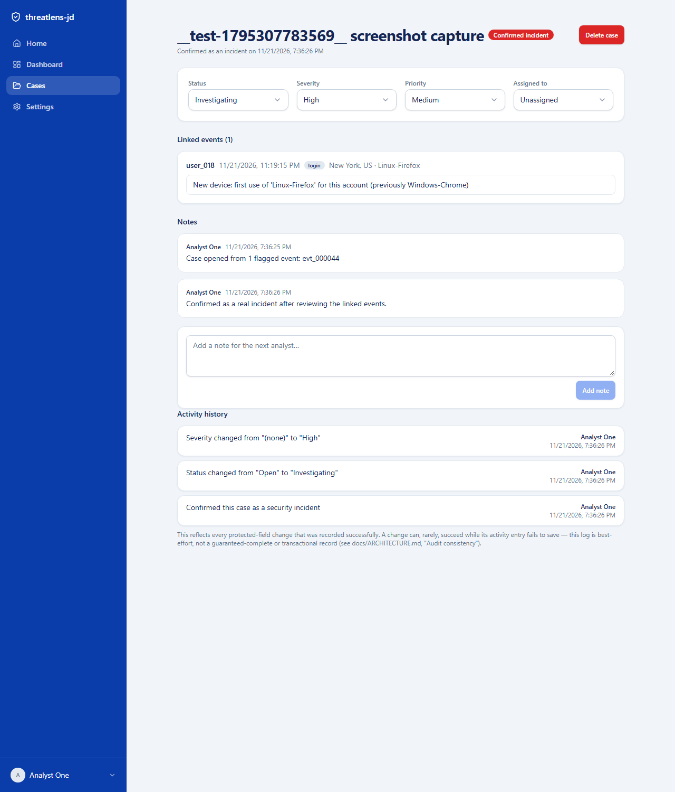
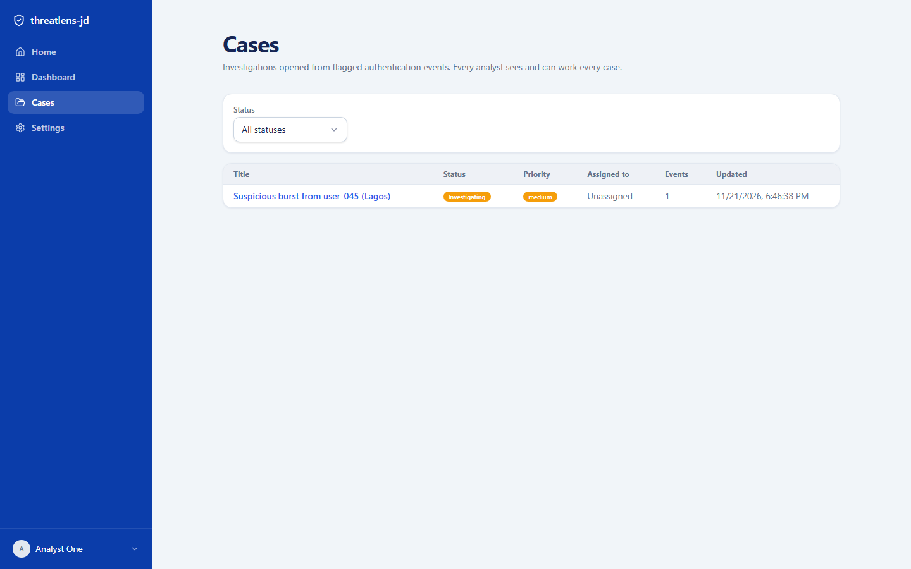
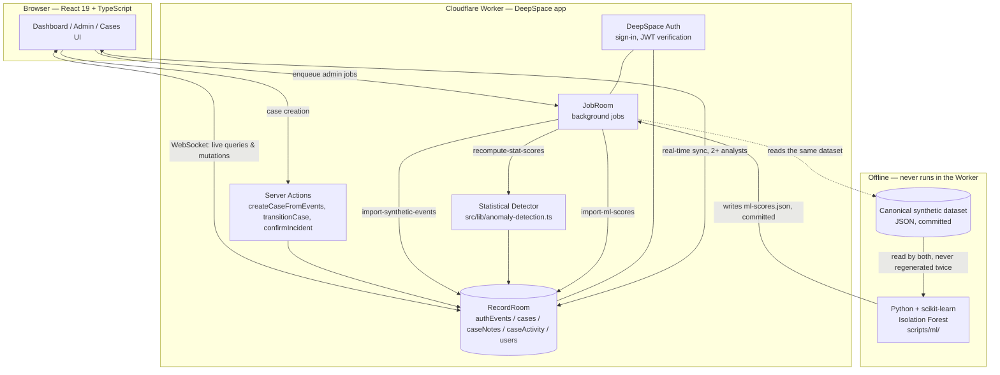

# ThreatLens

A collaborative authentication-anomaly investigation tool built on the
[DeepSpace](https://docs.deep.space) platform — real-time data sync,
role-based access control, and background jobs, with two independent
anomaly-detection layers: an explainable statistical rule engine that
runs live inside the app, and an offline Isolation Forest (scikit-learn)
model trained outside it.

Built for a DeepSpace Software Engineering Internship evaluation.

## The problem

Security teams reviewing authentication logs need two things that are
often in tension: detections they can **trust and explain** to a human
analyst, and detections that can **find patterns no one thought to write
a rule for**. ThreatLens ships both, clearly labeled, side by side, and
lets a small team of analysts turn a flagged event into a tracked,
collaborative investigation — without standing up a separate backend,
message queue, or database.

## Screenshots

**Dashboard** — live authentication events, an alert summary, two charts,
and both detection scores on every row.



**Event detail** — the statistical score's exact matched rule, the ML
score, and a plain-English note on what each one means and why they can
disagree.



**Case investigation** — status, severity, priority, assignment, incident
confirmation, linked events with their detection explanations, a note
thread, and a read-only activity history, all synced live between
analysts.





*All four screenshots are from the actual running app in local
development, with a committed synthetic dataset imported. No step shown
is mocked or illustrative.*

## What's actually implemented

- **Authentication & RBAC** — DeepSpace-managed sign-in (Google/GitHub),
  two roles (`member`/`admin`), every permission enforced server-side in
  the Durable Object, not just hidden in the UI (verified with direct
  WebSocket tests — see Testing).
- **Explainable statistical detection** — three named rules (failed-login
  burst, impossible travel, new device), each with a documented threshold,
  running live against every imported event. Every flag traces back to an
  exact rule and the numbers that triggered it.
- **Offline Isolation Forest ML detection** — a second, independent
  detector: 8 engineered features, trained and scored once outside the
  app (Cloudflare Workers cannot run Python), imported as a static
  enrichment. Evaluated against synthetic ground truth: **precision
  0.560, recall 0.667, F1 0.609** — full methodology and honest
  limitations in [`docs/ML_EVALUATION_REPORT.md`](docs/ML_EVALUATION_REPORT.md).
- **Collaborative case investigations** — open a case from one or more
  flagged events, track status/priority/assignment, add notes, all synced
  in real time between analysts (verified with two independent signed-in
  browser sessions, not mocked).
- **Incident-management extension** — severity, a one-way "confirm as
  incident" step with a server-generated timestamp, and a server-attributed
  activity history. Protected fields (`status`/`severity`/`priority`/
  `assignedTo`/`confirmedIncidentAt`) can only change through two server
  actions — proven server-side, not just hidden in the UI, with a direct
  raw-WebSocket test. The activity log is honestly documented as
  best-effort, not transactional: `docs/ARCHITECTURE.md`'s "Audit
  consistency" section explains why, and a real induced-failure test backs
  it up.
- **Admin console** — data import, detection recompute, and ML-score
  import, each a background job, each gated to the `admin` role at the
  Durable Object level.
- **Royal-blue, responsive, accessible UI** — a real DeepSpace theme (not
  hardcoded colors), a sidebar that collapses to a mobile drawer, keyboard
  navigable throughout.

## Architecture



**Why offline ML, not a live model in the Worker.** Cloudflare Workers run
JavaScript/Wasm — there is no Python runtime in the deployed app. The
Isolation Forest model is trained and scored once, by a human running a
script locally, and only its numeric output (a score and a flag per
event) is ever imported into DeepSpace, through the same admin-gated
background-job pattern used for every other bulk data operation in this
app. Full design rationale in
[`docs/ARCHITECTURE.md`](docs/ARCHITECTURE.md).

## Technology stack

| Layer | Technology |
|---|---|
| Platform | [DeepSpace SDK](https://docs.deep.space) on Cloudflare Workers / Durable Objects |
| Frontend | React 19, TypeScript, React Router (generouted file-based routing), Tailwind CSS v4 |
| Backend | Hono (routing), DeepSpace `RecordRoom`/`JobRoom`/server actions |
| Offline ML | Python 3, scikit-learn, NumPy, pandas, pytest |
| Testing | Playwright (real multi-user, real WebSocket tests), Vitest, pytest |
| Tooling | Vite, ESLint, Wrangler |

## DeepSpace capabilities used

- **Authentication** — `DeepSpaceAuthProvider`, `<AuthGate>`, `useAuth` (Google/GitHub sign-in, no custom auth code).
- **RecordRoom** — five collections (`users`, `authEvents`, `cases`, `caseNotes`, `caseActivity`) with per-role, per-operation AND per-field permissions enforced in the Durable Object (`cases`' `writableFields` locks protected fields to server-action-only writes).
- **JobRoom (background jobs)** — four admin-gated jobs: synthetic-data import, statistical-score recompute, ML-score import, each idempotent.
- **Server actions** — `createCaseFromEvents` (multi-collection orchestration at creation), and `transitionCase`/`confirmIncident` (the incident-management extension's only path for changing a protected case field, each pairing the change with a server-attributed activity record).
- **Real-time sync** — `useQuery`/`useMutations`, the mechanism behind every live update in the app; no polling or manual refresh anywhere.
- **User roster** — `useUsers()`/`useUserLookup()` for case assignment and note attribution.
- **Theming** — a real DeepSpace theme (`src/themes.css`), not hardcoded component colors.

## Local development

```bash
npm install
npx deepspace auth login      # first time only
npx deepspace dev start
```

Then, signed in as the app owner (automatically `admin`), visit `/admin`
and run, in order: **Import synthetic events** → **Recompute statistical
scores** → **Import ML scores**. This loads the committed 1,000-event
canonical dataset and both detection layers' precomputed results.

To regenerate the dataset or ML scores yourself:

```bash
node scripts/generate-dataset.mjs 1000 1337

python3 -m venv .venv-ml
source .venv-ml/Scripts/activate   # or .venv-ml/bin/activate on macOS/Linux
pip install -r scripts/ml/requirements.txt
python scripts/ml/train_and_evaluate.py
```

## Testing

```bash
npm run type-check                        # TypeScript
npm run lint                               # ESLint
npm run test:unit                          # Vitest (detection logic, dataset integrity)
npx deepspace test run e2e --port=5273     # Playwright: smoke, api, collab
pytest scripts/ml                          # Python: feature engineering, scoring, leakage
npm run build                              # production build
```

The Playwright suite includes real, non-mocked verification: two
independent signed-in browser sessions proving real-time case, severity,
incident-confirmation, and activity-history sync (with the non-owner
analyst doing the confirming, to also prove it isn't creator-restricted),
and direct raw-WebSocket attempts proving admin-only, ownership, and
protected-case-field RBAC are all enforced server-side, not just hidden in
the UI. `npm run test:unit` also covers the incident-management server
actions' internal logic against a fake `ActionTools`, including two
genuinely induced "primary write succeeds, activity write fails" partial-
failure scenarios.

## Deployment

```bash
npx deepspace deploy
```

**This app has not yet been deployed to a live URL as of this README.**
Local development and the full test suite are the verified state; a
deploy is a deliberate next step, not something to infer from this
document.

## ML evaluation — results and limitations

Full report: [`docs/ML_EVALUATION_REPORT.md`](docs/ML_EVALUATION_REPORT.md)
(generated directly from a real training run — the numbers in this README
are copied from it, not computed separately).

**Precision 0.560 · Recall 0.667 · F1 0.609**, against 1,000 synthetic
events with three deliberately-injected anomaly patterns. The model
catches 100% of `impossible_travel` and `brute_force_burst` events but
only 17.6% of `new_device_odd_hour` events — device novelty alone is a
weaker isolation signal than a large geographic or burst signal, a real
finding, not a tuned-to-look-good number.

**These numbers describe agreement with three known, author-injected
patterns in a small synthetic dataset. They are not, and must not be
read as, a measure of real-world detection accuracy** — the evaluation
report's "Limitations" section is the authoritative statement of what
these results do and don't mean, including that the model's
`contamination` parameter was informed by the dataset's own known
injection rate rather than discovered independently.

## Known limitations & possible future work

- Client-side filtering on the dashboard (`useQuery` + in-memory filter)
  won't scale past a few thousand rows — documented as the first thing
  to revisit, not a surprise.
- The ML import's bulk `tools.update` loop is sequential, one record at a
  time — fine at 1,000 rows, a revisit point at a much larger scale.
- One pre-existing scaffold test (`src/prerender-entry.test.tsx`) fails
  for reasons unrelated to this project's code — documented in
  [`docs/DEBUGGING_LOG.md`](docs/DEBUGGING_LOG.md) rather than silently
  worked around, and re-confirmed (via `git diff`, not assumption) to
  still predate every change in the incident-management extension.
- The incident-management extension's `caseActivity` log is best-effort,
  not transactional: RecordRoom has no cross-collection transaction
  primitive, so a case's protected-field write can, rarely, succeed while
  its paired activity write fails. Surfaced honestly (`activityRecorded:
  false`) and tested with a real induced failure, not hidden — see
  `docs/ARCHITECTURE.md`'s "Audit consistency." A reconciliation job to
  detect/backfill a dropped activity record was deliberately not built in
  this extension's 2-day scope — a named, open piece of further work.
- Optional, not-yet-built: CSV export of filtered events, additional
  chart types — intentionally out of scope for this submission.

## Documentation

- [`docs/ARCHITECTURE.md`](docs/ARCHITECTURE.md) — system design, data flow, and the tracked implementation roadmap.
- [`docs/CODE_WALKTHROUGH.md`](docs/CODE_WALKTHROUGH.md) — file-by-file feature explanations, including a full breakdown of exactly how ML scores are computed and what they mean.
- [`docs/INTERVIEW_PREP.md`](docs/INTERVIEW_PREP.md) — rubric-mapped explanations, practice exercises, and Q&A for each feature.
- [`docs/DEBUGGING_LOG.md`](docs/DEBUGGING_LOG.md) — real issues found and fixed during development, in the order they happened.
- [`docs/ML_EVALUATION_REPORT.md`](docs/ML_EVALUATION_REPORT.md) — full ML methodology, features, and evaluation results.
